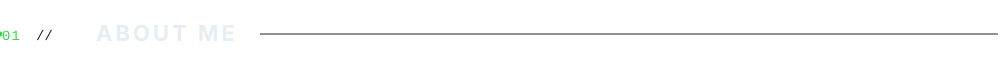
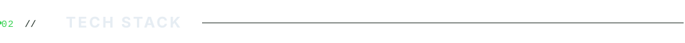
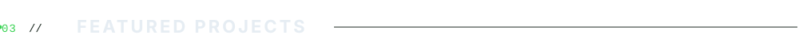
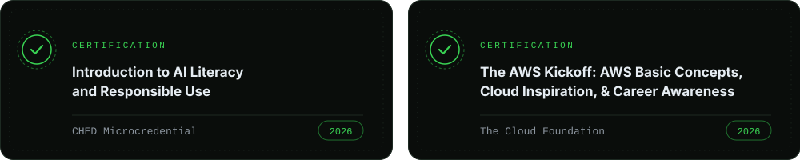
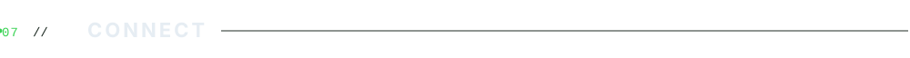

<!-- ───────────────────────────────── HERO ───────────────────────────────── -->
<p align="center">
  <a href="https://eptd.gajec.org">
    
  </a>
</p>

<p align="center">
  <sub>Computer Science student building practical web applications — one real project at a time.</sub>
</p>

<p align="center"></p>

<!-- ─────────────────────────────── ABOUT ME ─────────────────────────────── -->


I'm a Computer Science student at **Saint Louis University** with project experience in frontend development and some backend work. Most of what I've built so far comes from academic and team projects — a tourism destination-tracking app and a barangay issue-reporting platform — where I've learned how features get designed, built, fixed, and refined alongside other developers.

I'm drawn to building practical web applications, and I'm looking for a software development internship where I can apply what I know and keep growing through professional experience.

```ts
const edgard = {
  studying: "BS Computer Science @ Saint Louis University (2024–2028)",
  focus:    ["Frontend Development", "Practical Web Applications"],
  building: "Personal portfolio → eptd.gajec.org",
  seeking:  "Software development internship",
};
```

<!-- ─────────────────────────────── TECH STACK ───────────────────────────── -->


<p align="center">
  <br /><br />
  &nbsp;&nbsp;&nbsp;
</p>

<p align="center">
  <br /><br />
  &nbsp;&nbsp;&nbsp;&nbsp;
</p>

<p align="center">
  <br /><br />
  &nbsp;&nbsp;
</p>

<p align="center">
  <br /><br />
  &nbsp;
</p>

<!-- ──────────────────────────── FEATURED PROJECTS ───────────────────────── -->


<p align="center">
  
</p>
<p align="center"><sub>Team project · repository hosted on GitLab</sub></p>

<p align="center">
  <a href="https://github.com/GAJEC/community-feedback-wall">
    
  </a>
</p>
<p align="center"><a href="https://github.com/GAJEC/community-feedback-wall"><b>View repository →</b></a></p>

<p align="center">
  <a href="https://eptd.gajec.org">
    
  </a>
</p>
<p align="center"><a href="https://eptd.gajec.org"><b>Visit eptd.gajec.org →</b></a></p>

<!-- ───────────────────────────── CERTIFICATIONS ─────────────────────────── -->


<p align="center">
  
</p>

<!-- ────────────────────────────── GITHUB STATS ──────────────────────────── -->


<p align="center">
  
</p>

<!-- ───────────────────────────── CONTRIBUTIONS ──────────────────────────── -->


<p align="center">
  
</p>

<!-- ──────────────────────────────── CONNECT ─────────────────────────────── -->


<p align="center">
  <a href="https://github.com/EdgardPatrick"></a>&nbsp;&nbsp;
  <a href="https://www.linkedin.com/in/edgard-patrick/"></a>&nbsp;&nbsp;
  <a href="https://eptd.gajec.org"></a>
</p>

<p align="center">
  <a href="https://github.com/EdgardPatrick">GitHub</a> &nbsp;·&nbsp;
  <a href="https://www.linkedin.com/in/edgard-patrick/">LinkedIn</a> &nbsp;·&nbsp;
  <a href="https://eptd.gajec.org">Portfolio</a>
</p>

<!-- ──────────────────────────────── FOOTER ──────────────────────────────── -->
<p align="center"></p>
